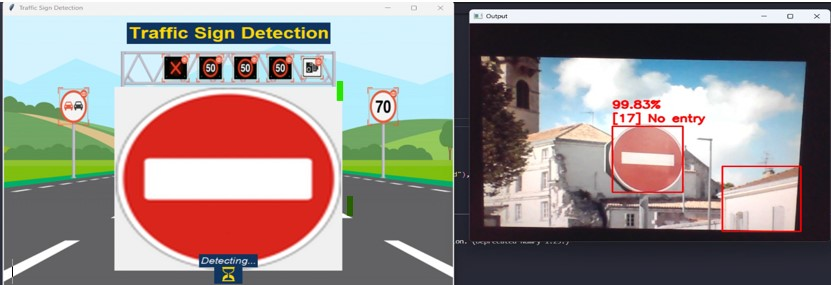
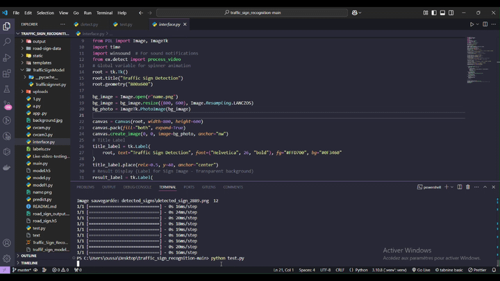
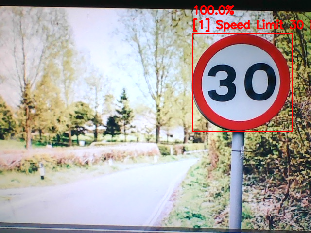
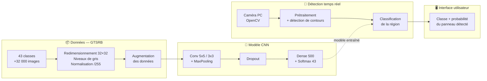

<div align="center">

#  Traffic Sign Detection

### Détection et reconnaissance des panneaux de signalisation en temps réel
<div align="center">



</div>
*Un réseau de neurones convolutifs (CNN), la vision par ordinateur et une
interface utilisateur pour détecter et classifier les panneaux routiers
en temps réel à partir de la caméra du PC.*


</div>

---

##  Sommaire

- [Traffic Sign Detection](#traffic-sign-detection)
    - [Détection et reconnaissance des panneaux de signalisation en temps réel](#détection-et-reconnaissance-des-panneaux-de-signalisation-en-temps-réel)
  - [Sommaire](#sommaire)
  - [Aperçu](#aperçu)
  - [Démo](#démo)
    - [Vidéo de démonstration](#vidéo-de-démonstration)
    - [Détection en temps réel](#détection-en-temps-réel)
    - [Interface utilisateur](#interface-utilisateur)
  - [Fonctionnalités](#fonctionnalités)
  - [Architecture](#architecture)
    - [Préparation des données](#préparation-des-données)
    - [Modèle CNN](#modèle-cnn)
    - [Détection en temps réel](#détection-en-temps-réel-1)
  - [Stack technique](#stack-technique)
  - [📁 Structure du dépôt](#-structure-du-dépôt)
  - [Démarrage rapide](#démarrage-rapide)
  - [Perspectives](#perspectives)
  - [👥 Équipe \& contexte](#-équipe--contexte)

---

##  Aperçu

**Traffic Sign Detection** est un système de vision par ordinateur et de
Deep Learning conçu pour améliorer la sécurité routière en détectant et en
reconnaissant automatiquement les panneaux de signalisation.

Une caméra capture un flux vidéo analysé image par image. Les zones
contenant un panneau sont localisées par détection de contours, puis
classifiées par un modèle CNN entraîné sur le dataset **GTSRB**
(43 classes). La classe du panneau et la probabilité associée sont
affichées en direct dans une interface utilisateur.

---

##  Démo

### Vidéo de démonstration



▶️ [Voir la vidéo complète](Results/Results.mp4)

### Détection en temps réel



### Interface utilisateur


---

##  Fonctionnalités

| | |
|---|---|
|  **Détection en temps réel** | Analyse du flux de la caméra du PC image par image |
|  **Classification de 43 classes** | Panneaux d'interdiction, d'avertissement et d'indication |
|  **Score de confiance** | Probabilité associée à chaque prédiction |
|  **Prédiction sur images fixes** | Test du modèle sur des images prises dans différentes conditions |
|  **Interface utilisateur** | Affichage clair du panneau détecté en direct |
|  **Robustesse** | Augmentation des données (décalage, rotation, zoom) pour mieux généraliser |

---

##  Architecture



###  Préparation des données

| Étape | Détail |
|---|---|
| Dataset | **GTSRB** (German Traffic Sign Recognition Benchmark), 43 classes |
| Séparation | 80 % entraînement / 20 % test, puis 20 % de l'entraînement pour la validation |
| Taille des images | 32×32 pixels |
| Prétraitement | Niveaux de gris, normalisation (division par 255) |
| Augmentation | Décalage, rotation, zoom |

###  Modèle CNN

- **Couches convolutionnelles** (noyaux 5×5 et 3×3) pour extraire les bords et les formes
- **MaxPooling** pour réduire la taille des données et gagner en robustesse
- **Dropout** pour limiter le surapprentissage
- **Couche dense** de 500 neurones puis **couche de sortie** de 43 neurones (softmax)

###  Détection en temps réel

1. Chargement du modèle entraîné
2. Capture vidéo via OpenCV
3. Prétraitement de l'image
4. Détection des contours et boîtes de délimitation
5. Redimensionnement des régions en 32×32 et prédiction (classe + probabilité)

---

##  Stack technique

<div align="center">

| Couche | Technologies |
|---|---|
| **Langage** | Python |
| **Deep Learning** | TensorFlow, Keras (CNN) |
| **Vision par ordinateur** | OpenCV |
| **Dataset** | GTSRB |
| **Environnement** | Visual Studio Code |
| **Gestion de projet** | Méthodologie agile SCRUM |

</div>

---

## 📁 Structure du dépôt

```
Traffic-Sign-Detection/
├── README.md                  # Ce fichier
├── demo/                      # Images de démonstration
│   ├── banner.png
│   ├── demo1.png
│   ├── demo2.png
│   └── demo-video.gif
├── Resultas/                  # Résultats (captures, courbes)
├── TrafficSignModel/          # Modèle entraîné (dossier)
├── traffic_sign_model.h5      # Modèle CNN entraîné (Keras)
├── labels.csv                 # Noms des 43 classes de panneaux
├── Train.py                   # Entraînement du modèle sur GTSRB
├── predict.py                 # Prédiction sur images fixes
├── Live-video-testing.py      # Détection en temps réel (caméra)
├── Detect-with-interface.py   # Détection en temps réel + interface
└── LICENSE
```

---

##  Démarrage rapide

```bash
# 1. Cloner le dépôt
git clone <url-du-depot>
cd Traffic-Sign-Detection

# 2. Installer les dépendances
pip install tensorflow opencv-python numpy matplotlib scikit-learn pandas
```

| Composant | Commande |
|---|---|
|  Entraînement | `python Train.py` (dataset GTSRB requis) |
|  Images fixes | `python predict.py` |
|  Temps réel | `python Live-video-testing.py` |
|  Temps réel + interface | `python Detect-with-interface.py` |

> Le modèle déjà entraîné `traffic_sign_model.h5` est fourni : tu peux
> lancer directement les scripts de détection sans ré-entraîner.

---

##  Perspectives

Une prochaine étape consiste à intégrer ce modèle dans un **robot autonome**
capable de naviguer en respectant les panneaux détectés, afin de valider le
système dans un environnement dynamique (véhicules autonomes, systèmes
d'assistance à la conduite).

---

## 👥 Équipe & contexte

Projet semestriel réalisé à l'**École Nationale d'Ingénieurs de Sousse**
(Université de Sousse), filière **Génie Informatique Appliqué**,
année universitaire 2024/2025.

> Ines Gardabbou

> Helmi Soudana

> Ahmed Naoui

---
